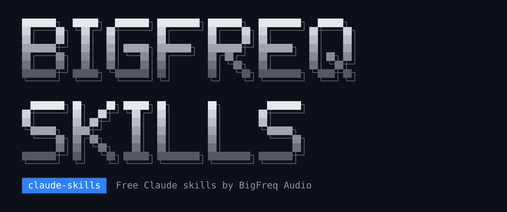
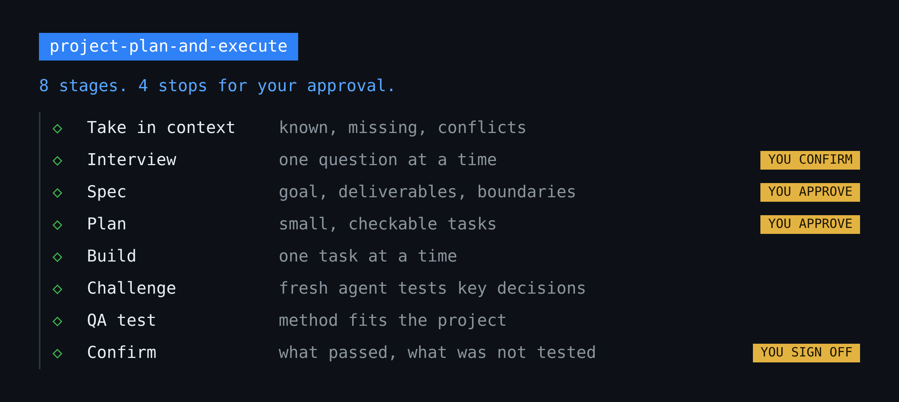
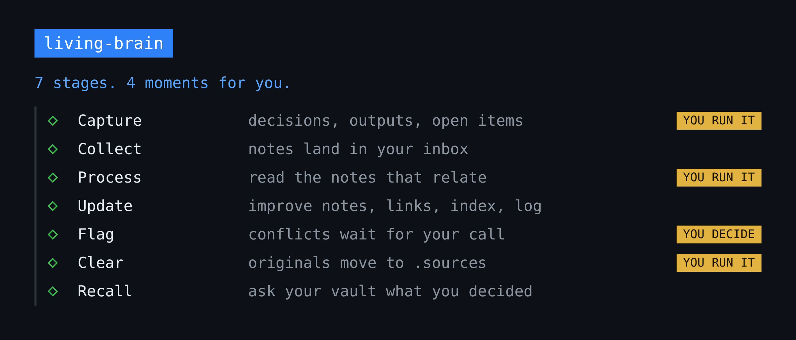

<p align="center">
  
</p>

<p align="center">
  
  
  
</p>

## Skills

1. 🗂️ [Project Plan and Execute](#1-%EF%B8%8F-project-plan-and-execute)
2. 🧠 [Living Brain](#2--living-brain)

## 1. 🗂️ Project Plan and Execute

Runs a whole project from your notes to final sign-off: software, marketing, web design, content or operations. It also works on projects already underway.

<p align="center">
  
</p>

The plan and progress live in project files, so a new chat can pick up where the last one stopped.

## Install

**With the skills CLI**

```
npx skills add BigFreq-Audio/claude-skills --skill project-plan-and-execute
```

**In Claude Code, manually**

Save [SKILL.md](skills/project-plan-and-execute/SKILL.md) to `~/.claude/skills/project-plan-and-execute/SKILL.md`.

**In the Claude app**

Put `SKILL.md` in a folder named `project-plan-and-execute` and zip the folder. Go to Customize > Skills, click +, choose Create skill, then Upload a skill.

## Use it

```
Use project-plan-and-execute. New project: [name]. Here's what I have: [notes or files]
```

## 2. 🧠 Living Brain

An original BigFreq workflow that turns your second brain into a living brain. Your decisions, finished work and open questions move from Claude chats into your Obsidian vault as you work, then become part of the wiki.

<p align="center">
  
</p>

A second brain only grows when you stop to feed it. Living Brain makes that one short command, so the thinking you do in chats keeps building your notes instead of disappearing into chat history.

### How it works

1. **Capture.** Type `/living-brain` at the end of a chat, or at any useful point in it. Claude writes a short note with what you decided, what you rejected and why, what you finished, what is still open, and anything worth keeping as a wiki page.
2. **Collect.** On the computer with your vault, the note lands in `00 Inbox/Captures/` straight away. On a second computer, it waits in a private cloud folder until a scheduled task brings it in, hourly by default.
3. **Process.** Say "process captures" whenever you are ready. Claude reads each note, then reads your index and the notes it relates to.
4. **Update.** Claude improves the notes you already have, instead of leaving another isolated page. It adds links and updates your index and log.
5. **Flag.** If a capture disagrees with something settled, Claude records the conflict and asks you. It never overwrites settled knowledge, and it never changes your rules, SOPs or skills without your approval.
6. **Clear.** Double-click `FILE-CAPTURES.bat`. It moves processed captures into a hidden `.sources/` folder, so your inbox is empty and the originals stay available to check.
7. **Recall.** Ask "Check the vault: what did we decide about X?" Claude answers from your notes and includes captures you haven't processed yet.

### What gets saved

Only your decisions, finished work, open items and reusable answers.

Living Brain never saves sensitive information or full chat transcripts.

You choose what enters your vault, because a note is only written when you run the command.

### Install

**With the skills CLI**

```
npx skills add BigFreq-Audio/claude-skills --skill living-brain
```

**In Claude Code, manually**

Save the [living-brain](skills/living-brain) folder to `~/.claude/skills/living-brain/`.

**In the Claude app**

Zip the `living-brain` folder. Go to Customize > Skills, click +, choose Create skill, then Upload a skill.

### Set it up

You need an Obsidian vault with an index note and a log note. The `.bat` helper is for Windows.

1. Add your vault path to `SKILL.md`. The skill stops and asks until this is done.
2. Create `00 Inbox/Captures/` and `.sources/ledger.csv` in your vault.
3. Copy `FILE-CAPTURES.bat` and `file-captures.ps1` to a `.tools/` folder in your vault.
4. Add the capture rule to your vault's `CLAUDE.md`.
5. Using a second computer? Set up the cloud folder and scheduled task.

[SETUP.md](skills/living-brain/SETUP.md) walks through every step.

### Use it

```
/living-brain
/living-brain the launch decisions
process captures
Check the vault: what did we decide about the launch date?
```

---

Project Plan and Execute is inspired by the spec-first workflow in [Addy Osmani's agent-skills](https://github.com/addyosmani/agent-skills). Living Brain is an original BigFreq workflow, built on ideas from [Andrej Karpathy's LLM Wiki](https://gist.github.com/karpathy/442a6bf555914893e9891c11519de94f). Not affiliated with Addy Osmani, Andrej Karpathy, Obsidian or Anthropic.
